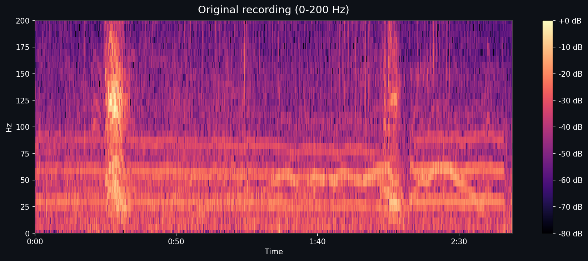
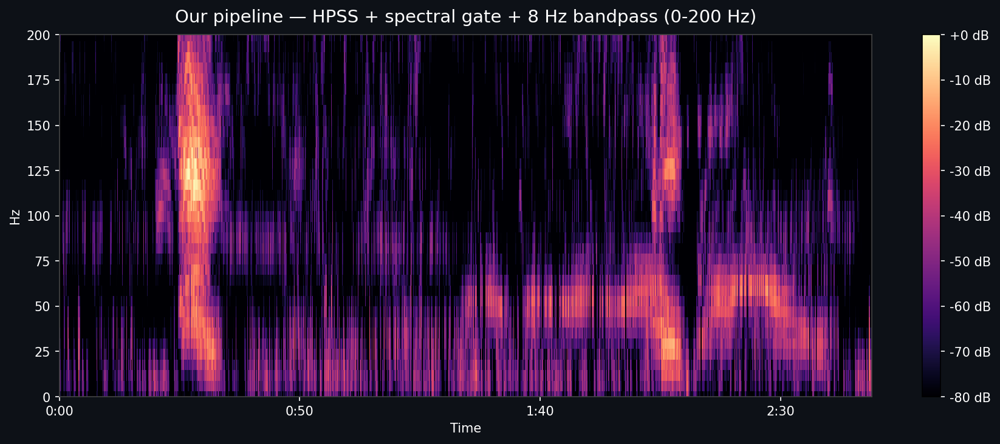

# EchoMap: Elephant Vocalization Denoising Platform

<p align="center">
  
  
</p>
<p align="center"><sub>same recording, 0 to 200 Hz. before on the left, after on the right.</sub></p>

**HackSMU VII / iMasons, ElephantVoices challenge:** remove overlapping mechanical noise (airplanes, cars, generators) from elephant field recordings *without* distorting the elephant calls.

The denoising pipeline uses classical DSP without ML. It's deterministic and exploits a structural difference rather than a frequency one: elephant rumbles are sustained harmonic bands, and mechanical noise is broadband and stationary.

## Pipeline (`backend/pipeline/process.py`)

1. **Load** at native sample rate (48 kHz), `sr=None` preserves 10–20 Hz infrasound.
2. **HPSS** (Harmonic-Percussive Source Separation): median filters isolate the harmonic component.
3. **Noise fingerprint**: per-recording, built from the HPSS-harmonic signal's silent gaps so it subtracts cleanly (this was a bug in earlier versions; see `process.py` docstring).
4. **Spectral subtraction** on the harmonic signal (`step4a`).
5. **8–1200 Hz Butterworth bandpass** (`step4b`), preserves infrasound down to 8 Hz.
6. **In-call energy ratio**: a *proxy* metric (not a true SNR; see evaluation below for real ground truth).

Every stage writes real audio + spectrograms (`harmonic.wav`, `gated.wav`, `cleaned.wav`), so the UI stage-toggle shows genuine intermediates.

## Evaluation (the honest bit)

The in-call/out-of-call energy ratio in the UI is a cleanup proxy and can be misleading on its own. For real ground-truth evaluation we built two off-line harnesses:

### `scripts/eval/`: SI-SDR on synthetic clean+noise mixes

5 labeled elephant rumbles × 2 noise types (generator, vehicle) × 4 input SNRs (−10, −5, 0, +5 dB) is 40 possible mixes, capped at 24 by `MAX_MIXES`, so the run reaches 3 of the 5 rumbles. We measure scale-invariant SDR improvement against the clean reference.

| Input SNR | SI-SDR Δ (dB) | Call-band cosine |
|---|---|---|
| −10 dB (noise-dominated) | **+1.9 ± 4.0** | 0.55 |
| −5 dB (heavy noise) | **+2.1 ± 2.5** | 0.77 |
| 0 dB | −0.0 ± 1.6 | 0.91 |
| +5 dB (already clean-ish) | −3.8 ± 1.4 | 0.96 |

**Finding:** the pipeline is a low-SNR rescue tool. It improves the recordings that are currently unusable, but will damage already-clean audio, so do not apply it blanket.

Reproduce: `python scripts/eval/build_mixes.py && python scripts/eval/run_eval.py`

### `scripts/compare/`: infrasound preservation vs. speech-trained denoisers

Generic speech denoisers (RNNoise / Meta Denoiser / Adobe Podcast) high-pass below ~80 Hz because speech has nothing useful there, which would obliterate every elephant fundamental. We simulate that behavior with a 100 Hz Butterworth HPF + aggressive spectral gate (clearly labeled as a simulation).

| Band | Ours | Speech-style proxy |
|---|---|---|
| **8–35 Hz (elephant fundamental)** | **−4.9 dB** (preserved) | **−44.3 dB** (destroyed) |
| 35–200 Hz (harmonics) | +2.2 dB | +2.4 dB |
| 200–1200 Hz (mid) | −3.4 dB | +3.8 dB |

**Finding:** ~39 dB advantage in the elephant fundamental band. Classical DSP beats the simulated proxy here. This is a simulation, not a head-to-head with RNNoise or the other real denoisers.

Reproduce: `python scripts/compare/infrasound_comparison.py`

## Backend

```bash
cd backend && python3 -m venv venv && source venv/bin/activate
pip install -r requirements.txt
cd ..
uvicorn backend.main:app --reload --port 8000
```

Batch process the dataset:

```bash
python -m backend.pipeline.process batch data/recordings data/calls.csv output
```

### API

- `GET /calls`: all processed recordings
- `GET /calls/{id}`: single recording detail
- `GET /calls/{id}/audio/{stage}`: `hpss | gated | clean` (real intermediate files)
- `GET /calls/{id}/spectrogram/{stage}`: same stages
- `GET /stats`: aggregate metrics
- `POST /process`: upload a `.wav`, run pipeline, return results
- `POST /query`: natural-language query over processed-recordings metrics (Gemini-backed chat; no vision, no classification)

## Frontend

```bash
cd frontend
npm install
npm run dev
```

Set `VITE_API_URL=http://localhost:8000` in `frontend/.env`.

## What this is *not*

- Not an ML model. The denoising pipeline uses classical DSP without ML: no training data, no GPU, no weights. Gemini backs the `POST /query` chat.
- Not a call classifier. `backend/main.py`, the backend this README runs, passes `call_type` through from the labeled CSV column. An older second backend in `backend/api/` still runs a Gemini Vision classifier during processing, and neither backend mounts `backend/api/routes/classify.py`.
- Not a universal denoiser. It's tuned for elephant rumbles in mechanical-noise-dominated recordings; it will hurt already-clean audio (see SI-SDR table).
- Not a fundamental-frequency estimator. At n\_fft=4096 / sr=48 kHz, the 8–35 Hz search range has only ~2 FFT bins, and previous versions produced a meaningless 2-valued output; this field has been removed.
