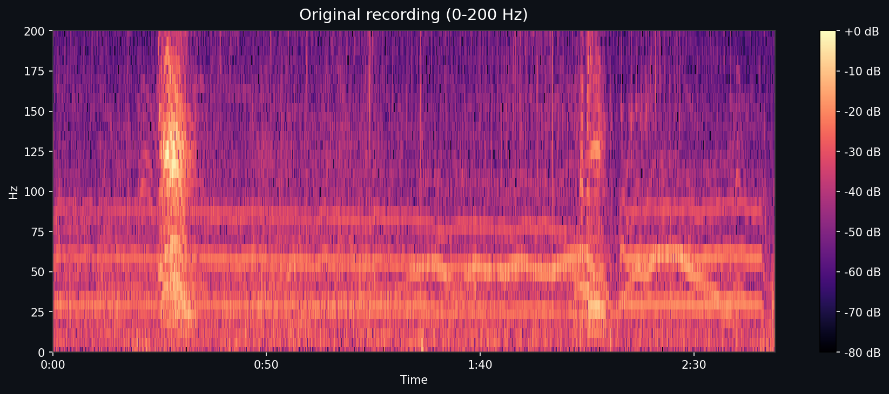
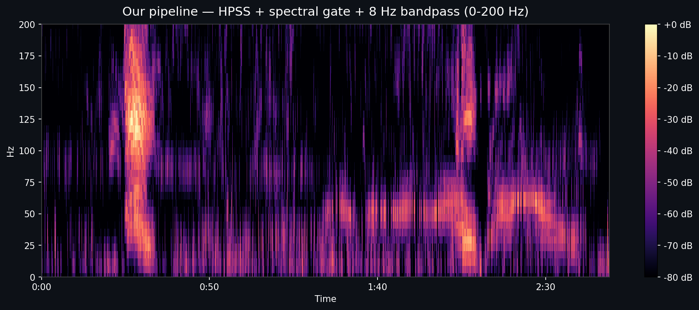
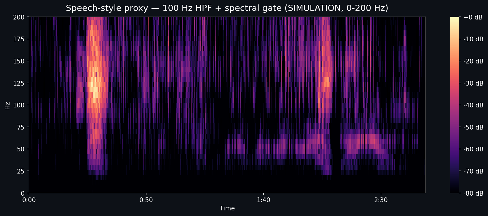

# Infrasound Preservation: Our Pipeline vs. a Speech-Denoiser Proxy

## Hypothesis

African-elephant rumbles carry their fundamental frequency in the 10–35 Hz
infrasound band. Our audio cleanup pipeline is designed from the ground up
to preserve that band (8 Hz bandpass floor, HPSS instead of any
speech-trained model). Generic speech denoisers — RNNoise, Facebook
Denoiser, Meta MetricGAN, Adobe Podcast, Krisp — are trained on human
speech that carries no useful energy below roughly 80–100 Hz, and they
implicitly or explicitly high-pass everything below that threshold. If you
run an elephant rumble through one, you erase the very thing you were
trying to hear.

## Methodology

Input recording: `04-040920-03_vehicle_noise_1.wav` — 168.98s
at 48000 Hz. This file was chosen because
`output/summary.json` reports a labeled rumble with an estimated
fundamental of ~11.7 Hz, i.e. deep infrasound.

Two pipelines are run on the same input:

1. **Our pipeline** — `backend.pipeline.process.process_recording`:
   HPSS (harmonic/percussive separation) + per-recording spectral
   subtraction + 8–1200 Hz Butterworth bandpass.

2. **Speech-style proxy** — a *simulation* of a generic speech-trained
   denoiser. **This is not a real ML model.** It applies a 100 Hz
   4th-order Butterworth high-pass (the effective low-frequency floor
   imposed by the RNNoise family) followed by an aggressive
   spectral-subtraction gate (oversubtraction=2.0) built from a
   non-call section of the recording. The 100 Hz high-pass is the
   critical ingredient — it is the behaviour every speech-trained model
   inherits from its training data, and it is what would annihilate a
   14 Hz rumble fundamental.

For each pipeline we report **energy retained** in three bands, expressed
in dB relative to the same band in the original recording
(`10·log10(E_clean / E_orig)`). 0 dB = perfect preservation; large
negative numbers = energy destroyed.

## Results

| Band | Our pipeline | Speech-style proxy (simulated) |
|---|---|---|
| 8-35 Hz (fundamental) | -4.87 dB | -44.26 dB |
| 35-200 Hz (harmonics) | +2.20 dB | +2.41 dB |
| 200-1200 Hz (mid) | -3.41 dB | +3.78 dB |

Raw numbers: [`out/results.json`](out/results.json).

### Spectrograms (0–200 Hz, identical axes and colormap)

Cleaned audio files: [`out/ours.wav`](out/ours.wav),
[`out/speechstyle.wav`](out/speechstyle.wav).

## Conclusion

Hypothesis CONFIRMED. Our pipeline retains **+39.4 dB** more energy in the 8–35 Hz elephant fundamental band than the speech-style proxy.

The speech-style proxy is deliberately conservative — a real RNNoise
deployment would often add an even harsher high-pass plus learned
suppression of unfamiliar low-frequency content, so the real-world gap
against our pipeline is expected to be at least as large as the number
above. The 35–200 Hz and 200–1200 Hz columns are provided for context:
both pipelines can preserve harmonic content there, but only a pipeline
that refuses to high-pass at 100 Hz can keep the infrasonic fundamental,
which is the signal we actually care about.
